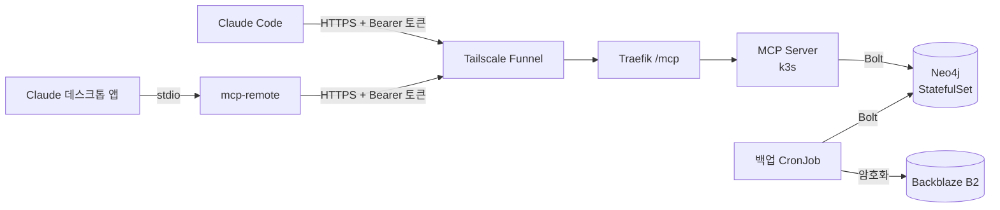

# Personal Knowledge Graph MCP Server

[English](README.md) | **한국어**

Claude(claude.ai / Claude Desktop / Claude Code)가 사용자에 대한 장기 기억을 **지식 그래프**로 조회·기록할 수 있게 하는 MCP 서버.
프로젝트, 기술 스택, 의사결정, 경력, 일정을 노드와 관계로 저장하고, LLM이 대화 중 필요한 맥락을 쿼리하거나 새 사실을 적재한다.



- **언어**: Python 3.12 + [FastMCP](https://gofastmcp.com)
- **DB**: Neo4j 5 Community
- **배포**: 홈 k3s 클러스터([k3s-msa-infrastructure](https://github.com/sm010422/k3s-msa-infrastructure)), ArgoCD GitOps
  - 공개 엔드포인트: `https://k3s-master.taildcdcee.ts.net/mcp` (토큰 필수)
  - CI: GitHub Actions → arm64 이미지 → 매니페스트 태그 커밋 → ArgoCD sync

## 다른 도구와 비교

| | 이 서버 | 공식 [`server-memory`](https://github.com/modelcontextprotocol/servers/tree/main/src/memory) | [Graphiti](https://github.com/getzep/graphiti) (Zep) | [mem0](https://github.com/mem0ai/mem0) |
|---|---|---|---|---|
| 저장소 | Neo4j | 로컬 JSON 파일 | 그래프 DB (Neo4j 등) | 벡터 스토어, 그래프는 선택 |
| 사실이 들어가는 방식 | Claude가 명시적인 툴(`upsert_entity`, `add_relation` 등)을 호출 | Claude가 명시적인 툴을 호출 | LLM이 대화(episode)에서 추출 | LLM이 대화에서 추출 |
| 쓰기 시 추가 LLM 호출 / API 키 | 없음 | 없음 | 있음 | 있음 |
| 사실이 바뀌면 | 이전 관계를 닫고(`validFrom`/`validTo`), 바뀐 속성은 이력으로 남김 | 덮어씀 | 유효 기간이 있는 엣지 | LLM이 메모리를 수정하거나 삭제 |

이 서버만의 특징:

- **"그때는 무엇이 사실이었나"를 물을 수 있다.** 관계에 유효 기간이 있고 엔티티는 변경 이력을 남긴다. 그래서 "지금 무엇이 사실인가"뿐 아니라 "2025년에 어디서 일했나", "X를 언제 그만 썼나"에도 답할 수 있다.
- **민감정보를 코드로 막는다.** 건강, 재정, 인증 정보, 식별번호 필드는 프롬프트가 아니라 정책 검사에서 거부된다([security.md](docs/security.md)).
- **한국어 전문 검색.** 전문 인덱스는 Neo4j의 CJK analyzer를 쓰고, 이름·alias 정확 일치와 부분 일치도 함께 본다.
- **셀프 호스팅, 추가 모델 없음.** 모든 데이터는 내 Neo4j에 있고, LLM은 이미 대화 중인 Claude 하나뿐이다.

어시스턴트가 무엇을 저장할지 고르지 않고 모든 대화에서 자동으로 기억을 추출하고 싶다면 Graphiti나 mem0가, 의존성 없는 파일 하나면 충분하다면 `server-memory`가 더 맞다.

## 툴

| 툴 | 하는 일 |
|---|---|
| `upsert_entity` | 엔티티 생성/갱신. 이름·alias로 기존 엔티티를 찾고, 바뀐 속성은 이력으로 남김 |
| `add_relation` | 두 엔티티 연결. 같은 관계의 속성이 바뀌면 이전 관계를 닫고 새로 엶 |
| `end_relation` | "더 이상 사실이 아님" 표시 (퇴사, 기술 사용 중단) |
| `add_note` | 엔티티에 붙는 자유 텍스트 관찰 |
| `get_context` | 엔티티 주변 1~2단계 서브그래프를 Markdown으로 반환. 긴 노트는 300자 미리보기와 id만 |
| `get_note` | 노트 하나의 전문 |
| `search` | 이름·alias·요약·노트 전문 검색 (한국어 지원) |
| `list_entities` | 타입·속성 조건으로 나열, 또는 N일 넘게 안 바뀐 것만 |
| `upcoming_events` | 앞으로 N일 안의 Event(마감·면접)를 가까운 순으로 |
| `graph_stats` | 엔티티·관계·노트 개수 |
| `merge_entities` | 중복 엔티티를 다른 쪽으로 합침. 관계·노트·alias가 옮겨 감 |
| `delete_entity` | 미리보기 → soft delete → (명시 시) hard delete |
| `delete_note` | 미리보기 → 노트 하나 삭제 |

`get_context` 출력 예 (가상 데이터):

```markdown
# Organization: Example Corp
- kind: company

## Relations (3)
- Person:Jordan Lee -APPLIED_TO {status: document}-> **this** (2026-10-01 ~ 2026-10-15, ended)
- Person:Jordan Lee -APPLIED_TO {status: interview}-> **this** (since 2026-10-15)
- Event:Example Corp interview -CONCERNS-> **this** (since 2026-10-19)
```

## 빠른 시작 (5분)

필요한 것: [Docker](https://docs.docker.com/get-docker/), [Claude Code](https://docs.claude.com/en/docs/claude-code)

```bash
git clone https://github.com/sm010422/personal-knowledge-graph-mcp && cd personal-knowledge-graph-mcp
./scripts/quickstart.sh
```

스크립트가 랜덤 Neo4j 비밀번호와 MCP 토큰으로 `.env`를 만들고(화면에 출력하지 않는다), 서버 이미지를 로컬에서 빌드한 뒤(amd64·arm64 모두 가능) Neo4j와 MCP 서버를 `localhost`에 띄운다. 같은 디렉터리에서 Claude Code를 연결한다.

```bash
claude mcp add --transport http personal-kg http://localhost:8000/mcp \
  --header "Authorization: Bearer $(sed -n 's/^MCP_AUTH_TOKEN=//p' .env)"
```

`claude`를 실행하고 기억할 만한 걸 말해 본다("CLI 사이드 프로젝트 때문에 Rust 공부 중이야"). 새 세션에서 나에 대해 아는 걸 물어보면 꺼내 온다.

- 데이터는 Docker 볼륨에 있어서 재시작해도 남는다. `docker compose down`은 중지, `docker compose down -v`는 데이터까지 삭제한다.
- Neo4j Browser로 그래프 보기: http://localhost:7474 (user `neo4j`, 비밀번호는 `.env`)
- 선택: 가상 예시 데이터 `uv run --project server python scripts/seed_example.py`

### 다른 클라이언트 연결

**Claude 데스크톱 앱.** 앱은 서버를 stdio로 띄운다. 그래서 [uv](https://docs.astral.sh/uv/)로 GitHub에서 바로 서버를 실행하고, 위에서 띄운 Neo4j에 붙인다. `~/Library/Application Support/Claude/claude_desktop_config.json`의 `mcpServers`에 추가하고 앱을 ⌘Q로 재시작한다.

```json
"personal-kg": {
  "command": "uvx",
  "args": ["--from", "git+https://github.com/sm010422/personal-knowledge-graph-mcp#subdirectory=server", "pkg-mcp"],
  "env": {
    "NEO4J_URI": "bolt://localhost:7687",
    "NEO4J_PASSWORD": "<.env의 NEO4J_PASSWORD>"
  }
}
```

앱 로그에 `uvx`를 찾을 수 없다고 나오면, 앱이 셸의 `PATH`를 못 보는 것이다. `which uvx`로 나온 전체 경로를 `command`에 넣는다.

**Claude Code를 stdio로** (MCP 컨테이너 없이 Neo4j만: `docker compose up -d --wait neo4j`):

```bash
claude mcp add personal-kg \
  -e NEO4J_URI=bolt://localhost:7687 -e NEO4J_PASSWORD=<.env의 NEO4J_PASSWORD> \
  -- uvx --from "git+https://github.com/sm010422/personal-knowledge-graph-mcp#subdirectory=server" pkg-mcp
```

서버는 실행 위치(cwd)의 `.env`만 읽는다. 클라이언트가 띄울 때는 cwd가 레포가 아니므로 stdio 설정에서는 환경변수를 직접 넘긴다.

### 서버에 올려서 쓰기

같은 이미지를 HTTP 모드(`MCP_TRANSPORT=http`, `NEO4J_URI`, `NEO4J_PASSWORD`, `MCP_AUTH_TOKEN`)로 HTTPS 뒤에 띄우고, `claude mcp add --transport http <url> --header "Authorization: Bearer <token>"`으로 등록한다. 토큰 검사는 내장돼 있지만 URL에 닿는 누구나 토큰을 시도할 수 있으니 길고 랜덤하게 만든다.

이 레포 작성자의 구성(홈 k3s, ArgoCD, Tailscale Funnel, 매일 암호화 백업, `mcp-remote`로 데스크톱 앱 연결)은 [docs/deployment.md](docs/deployment.md)에 있다.

## 개발

```bash
cd server
uv run pytest                 # 단위 + 통합(Testcontainers, Docker 필요)
uv run pytest tests/unit      # Docker 없이
uv run ruff check . && uv run ruff format --check .
```

## 레포 구조

```
server/                 MCP 서버 (uv 프로젝트)
  Dockerfile            arm64, non-root 이미지
  src/pkg_mcp/
    server.py           툴 정의, lifespan(백그라운드 DB 연결), 프로브, stdio/http 진입점
    auth.py             HTTP 모드 Bearer 토큰 검증
    repository.py       Cypher 계층 — 엔티티 해석, 이력, 검색
    schema.py           엔티티/관계 어휘, 관계 방향 규칙, 반환 모델
    policy.py           민감정보 저장 차단
    formatting.py       get_context → Markdown
    db.py, config.py    드라이버, 제약/인덱스, 설정
    backup.py           pkg-mcp-backup: 그래프 전체 export/restore
    observability.py    Sentry 에러 보고 (SENTRY_DSN 있을 때만, 개인 데이터 제거)
  tests/unit, tests/integration
docs/
  architecture.md  schema.md  security.md
  adr/              설계 결정 기록
  devlog/           진행 과정 기록
k8s/                    클러스터 매니페스트 (ArgoCD가 sync)
  neo4j.yaml  mcp-server.yaml  ingress.yaml  networkpolicy.yaml  kustomization.yaml
  backup-cronjob.yaml   매일 암호화 백업 → Backblaze B2
  secret.example.yaml   템플릿만 — 실제 Secret은 kubectl로 생성
  cloudflare-tunnel/    비활성, 도메인 생기면 전환
.github/workflows/ci.yml  test → arm64 build → 태그 커밋
scripts/seed_example.py   가상 인물 예시 데이터
scripts/*backup*.sh       백업 Secret 생성, 로컬 rclone 설정
scripts/create-sentry-secret.sh  Sentry DSN Secret 생성
docker-compose.yml        로컬 Neo4j + MCP 서버(HTTP)
scripts/quickstart.sh     .env 생성 후 docker compose 실행
```

## 문서

- [아키텍처](docs/architecture.md) · [요청 흐름 다이어그램](docs/request-flow.md) · [그래프 스키마](docs/schema.md) · [보안·개인정보 정책](docs/security.md) · [Sentry·Istio·Kiali 검토](docs/observability-sentry-istio-kiali.md)
- [할 일 · 알아둘 점](docs/TODO.md) — 현재 상태, 주의사항, 우선순위별 할 일
- [배포·운영 가이드](docs/deployment.md) — k3s 구성, CI, 토큰 교체, 롤백, 장애 대응
- [ADR 목록](docs/adr/README.md)
- 진행 기록: [Phase 1 시작](docs/devlog/2026-10-19-phase1-bootstrap.md) · [Phase 2 k3s 배포](docs/devlog/2026-10-19-phase2-k3s-deployment.md) · [백업·첫 사용](docs/devlog/2026-10-27-backup-and-first-use.md) · [검색 AND/OR/NOT 버그 수정](docs/devlog/2026-11-02-lucene-operator-search-bug.md) · [공개 정비·첫 그래프 점검](docs/devlog/2026-11-02-public-polish-and-first-graph-audit.md) · [조회 비용·일정·정리 도구](docs/devlog/2026-11-05-context-cost-events-and-maintenance-tools.md)

## 로드맵

1. **Phase 1** — 로컬: docker-compose + stdio 모드 + 핵심 툴 + 통합 테스트 ✅
2. **Phase 2** — HTTP 모드 + 토큰 인증 + k3s 배포 + 외부 노출 ✅
   - 외부 노출은 Tailscale Funnel로 했다. Cloudflare Tunnel은 준비만 해 두었다([ADR-0009](docs/adr/0009-expose-via-tailscale-funnel.md)).
3. Phase 3 — 백업 CronJob ✅ ([ADR-0011](docs/adr/0011-logical-backup-to-b2.md)), Sentry 에러 보고 ✅(DSN 등록 대기), Prometheus 메트릭(툴 호출 수/지연/에러), Grafana 대시보드
4. Phase 4 — 대화 텍스트에서 LLM으로 엔티티/관계 자동 추출, 시간축 질의

## 개인정보

실제 개인 데이터, DB 덤프, 시드 데이터는 커밋하지 않는다. 예시와 테스트 데이터는 모두 가상 인물이다. 건강, 재정, 인증 정보, 식별번호는 저장하지 않으며 코드로도 차단한다([security.md](docs/security.md)).

## 라이선스

[MIT](LICENSE)
