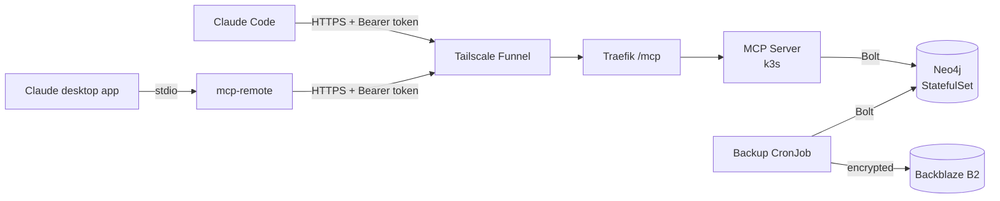

# Personal Knowledge Graph MCP Server

**English** | [한국어](README.ko.md)

An MCP server that gives Claude (claude.ai / Claude Desktop / Claude Code) long-term memory about the user, stored as a **knowledge graph**.
Projects, tech stack, decisions, career and schedule are stored as nodes and relations; the LLM queries the context it needs during a conversation and records new facts.



- **Language**: Python 3.12 + [FastMCP](https://gofastmcp.com)
- **DB**: Neo4j 5 Community
- **Deployment**: home k3s cluster ([k3s-msa-infrastructure](https://github.com/sm010422/k3s-msa-infrastructure)), ArgoCD GitOps
  - Public endpoint: `https://k3s-master.taildcdcee.ts.net/mcp` (token required)
  - CI: GitHub Actions → arm64 image → manifest tag commit → ArgoCD sync

## Tools

| Tool | What it does |
|---|---|
| `upsert_entity` | Create or update an entity. Finds an existing one by name or alias and keeps changed properties as history |
| `add_relation` | Connect two entities. If the properties of the same relation change, the old relation is closed and a new one opened |
| `end_relation` | Mark something as "no longer true" (left a job, stopped using a technology) |
| `add_note` | Free-text observation attached to an entity |
| `get_context` | Returns the 1–2 hop subgraph around an entity as Markdown |
| `search` | Full-text search over names, aliases, summaries and notes (Korean supported) |
| `list_entities` | List by type and property filters |
| `delete_entity` | Preview → soft delete → (when explicit) hard delete |

Example `get_context` output (fictional data):

```markdown
# Organization: Example Corp
- kind: company

## Relations (3)
- Person:Jordan Lee -APPLIED_TO {status: document}-> **this** (2026-10-01 ~ 2026-10-15, ended)
- Person:Jordan Lee -APPLIED_TO {status: interview}-> **this** (since 2026-10-15)
- Event:Example Corp interview -CONCERNS-> **this** (since 2026-10-19)
```

## Quick start

Requirements: Docker (Colima/OrbStack/Docker Desktop), [uv](https://docs.astral.sh/uv/)

```bash
cp .env.example .env              # change NEO4J_PASSWORD
docker compose up -d --wait       # Neo4j (browser UI: http://localhost:7474)
uv sync --project server
uv run --project server python scripts/seed_example.py   # optional: fictional example data
```

The server reads `.env` from its working directory. When Claude launches the server, the working directory is not the repo root, so pass the environment variables directly as shown below.

### Connect Claude Code — remote server on the cluster (recommended)

The token is the value saved to the local `.env.remote` (git-ignored) when the cluster Secret was created ([deployment.md](docs/deployment.md#secret-생성-최초-1회), in Korean).

```bash
source .env.remote
claude mcp add --transport http personal-kg "$MCP_URL" --header "Authorization: Bearer $MCP_AUTH_TOKEN"
```

### Connect Claude Code — local stdio

```bash
claude mcp add personal-kg \
  -e NEO4J_URI=bolt://localhost:7687 -e NEO4J_USER=neo4j -e NEO4J_PASSWORD=<same value as .env> \
  -- uv run --project /absolute/path/personal-knowledge-graph-mcp/server pkg-mcp
```

### Connect the Claude desktop app — remote server on the cluster (recommended)

The app settings have no field for HTTP headers. So [`mcp-remote`](https://www.npmjs.com/package/mcp-remote) talks stdio to the app and relays to the remote HTTP endpoint with the token attached. Add this to `mcpServers` in `~/Library/Application Support/Claude/claude_desktop_config.json` and restart the app with ⌘Q.

```json
"personal-kg": {
  "command": "npx",
  "args": ["-y", "mcp-remote", "https://k3s-master.taildcdcee.ts.net/mcp",
           "--header", "Authorization:${AUTH_HEADER}"],
  "env": { "AUTH_HEADER": "Bearer <MCP_AUTH_TOKEN from .env.remote>" }
}
```

- Keep `Authorization:${AUTH_HEADER}` exactly as is, with no space. A space inside an argument makes the app split it wrongly.
- Logs: `~/Library/Logs/Claude/mcp-server-personal-kg.log`. If you see `npm error EACCES`, `~/.npm` has root-owned files → `sudo chown -R 501:20 ~/.npm`.

### Connect Claude Desktop — local stdio (for development)

This connects to the local docker compose Neo4j. It is a **different DB** from the cluster one, so for real use stick to the remote server only.

`~/Library/Application Support/Claude/claude_desktop_config.json`:

```json
{
  "mcpServers": {
    "personal-kg": {
      "command": "uv",
      "args": ["run", "--project", "/absolute/path/personal-knowledge-graph-mcp/server", "pkg-mcp"],
      "env": {
        "NEO4J_URI": "bolt://localhost:7687",
        "NEO4J_USER": "neo4j",
        "NEO4J_PASSWORD": "<same value as .env>"
      }
    }
  }
}
```

## Development

```bash
cd server
uv run pytest                 # unit + integration (Testcontainers, needs Docker)
uv run pytest tests/unit      # without Docker
uv run ruff check . && uv run ruff format --check .
```

## Repository layout

```
server/                 MCP server (uv project)
  Dockerfile            arm64, non-root image
  src/pkg_mcp/
    server.py           tool definitions, lifespan (background DB connect), probes, stdio/http entry points
    auth.py             Bearer token check in HTTP mode
    repository.py       Cypher layer — entity resolution, history, search
    schema.py           entity/relation vocabulary, relation direction rules, return models
    policy.py           blocks storing sensitive information
    formatting.py       get_context → Markdown
    db.py, config.py    driver, constraints/indexes, settings
    backup.py           pkg-mcp-backup: export/restore of the whole graph
    observability.py    Sentry error reporting (only when SENTRY_DSN is set, personal data stripped)
  tests/unit, tests/integration
docs/
  architecture.md  schema.md  security.md
  adr/              architecture decision records
  devlog/           progress log
k8s/                    cluster manifests (synced by ArgoCD)
  neo4j.yaml  mcp-server.yaml  ingress.yaml  networkpolicy.yaml  kustomization.yaml
  backup-cronjob.yaml   daily encrypted backup → Backblaze B2
  secret.example.yaml   template only — the real Secret is created with kubectl
  cloudflare-tunnel/    inactive, to switch to once there is a domain
.github/workflows/ci.yml  test → arm64 build → tag commit
scripts/seed_example.py   fictional example data
scripts/*backup*.sh       create backup Secret, local rclone setup
scripts/create-sentry-secret.sh  create Sentry DSN Secret
docker-compose.yml        local Neo4j
```

## Docs

The documents under `docs/` are written in Korean.

- [Architecture](docs/architecture.md) · [Request flow diagrams](docs/request-flow.md) · [Graph schema](docs/schema.md) · [Security & privacy policy](docs/security.md) · [Sentry/Istio/Kiali review](docs/observability-sentry-istio-kiali.md)
- [TODO & notes](docs/TODO.md) — current state, caveats, prioritized to-dos
- [Deployment & operations guide](docs/deployment.md) — k3s setup, CI, token rotation, rollback, incident response
- [ADR index](docs/adr/README.md)
- Devlog: [Phase 1 start](docs/devlog/2026-10-19-phase1-bootstrap.md) · [Phase 2 k3s deployment](docs/devlog/2026-10-19-phase2-k3s-deployment.md) · [Backup & first use](docs/devlog/2026-10-27-backup-and-first-use.md) · [Search AND/OR/NOT bug fix](docs/devlog/2026-11-02-lucene-operator-search-bug.md)

## Roadmap

1. **Phase 1** — local: docker-compose + stdio mode + core tools + integration tests ✅
2. **Phase 2** — HTTP mode + token auth + k3s deployment + public exposure ✅
   - Exposed through Tailscale Funnel. Cloudflare Tunnel is prepared but not active ([ADR-0009](docs/adr/0009-expose-via-tailscale-funnel.md)).
3. Phase 3 — backup CronJob ✅ ([ADR-0011](docs/adr/0011-logical-backup-to-b2.md)), Sentry error reporting ✅ (waiting for DSN), Prometheus metrics (tool call count/latency/errors), Grafana dashboard
4. Phase 4 — LLM extraction of entities/relations from conversation text, temporal queries

## Privacy

Real personal data, DB dumps and seed data are never committed. All examples and test data use fictional people. Health, financial, credential and ID-number information is not stored, and the code blocks it ([security.md](docs/security.md)).
