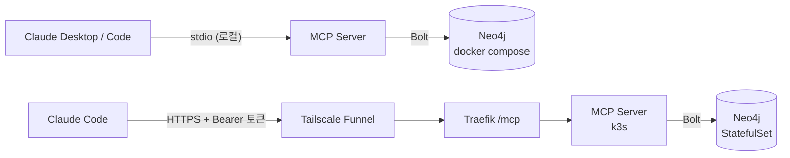

# Personal Knowledge Graph MCP Server

Claude(claude.ai / Claude Desktop / Claude Code)가 사용자에 대한 장기 기억을 **지식 그래프**로 조회·기록할 수 있게 하는 MCP 서버.
프로젝트, 기술 스택, 의사결정, 경력, 일정을 노드와 관계로 저장하고, LLM이 대화 중 필요한 맥락을 쿼리하거나 새 사실을 적재한다.



- **언어**: Python 3.12 + [FastMCP](https://gofastmcp.com)
- **DB**: Neo4j 5 Community
- **배포**: 홈 k3s 클러스터([k3s-msa-infrastructure](https://github.com/sm010422/k3s-msa-infrastructure)), ArgoCD GitOps
  - 공개 엔드포인트: `https://k3s-master.taildcdcee.ts.net/mcp` (토큰 필수)
  - CI: GitHub Actions → arm64 이미지 → 매니페스트 태그 커밋 → ArgoCD sync

## 툴

| 툴 | 하는 일 |
|---|---|
| `upsert_entity` | 엔티티 생성/갱신. 이름·alias로 기존 엔티티를 찾고, 바뀐 속성은 이력으로 남김 |
| `add_relation` | 두 엔티티 연결. 같은 관계의 속성이 바뀌면 이전 관계를 닫고 새로 엶 |
| `end_relation` | "더 이상 사실이 아님" 표시 (퇴사, 기술 사용 중단) |
| `add_note` | 엔티티에 붙는 자유 텍스트 관찰 |
| `get_context` | 엔티티 주변 1~2단계 서브그래프를 Markdown으로 반환 |
| `search` | 이름·alias·요약·노트 전문 검색 (한국어 지원) |
| `list_entities` | 타입·속성 조건으로 나열 |
| `delete_entity` | 미리보기 → soft delete → (명시 시) hard delete |

`get_context` 출력 예 (가상 데이터):

```markdown
# Organization: Example Corp
- kind: company

## Relations (3)
- Person:Jordan Lee -APPLIED_TO {status: document}-> **this** (2026-10-01 ~ 2026-10-15, ended)
- Person:Jordan Lee -APPLIED_TO {status: interview}-> **this** (since 2026-10-15)
- Event:Example Corp interview -CONCERNS-> **this** (since 2026-10-19)
```

## 빠른 시작

필요한 것: Docker(Colima/OrbStack/Docker Desktop), [uv](https://docs.astral.sh/uv/)

```bash
cp .env.example .env              # NEO4J_PASSWORD 변경
docker compose up -d --wait       # Neo4j (브라우저 UI: http://localhost:7474)
uv sync --project server
uv run --project server python scripts/seed_example.py   # 선택: 가상 예시 데이터
```

서버는 실행 위치(cwd)의 `.env`를 읽는다. Claude가 서버를 띄울 때는 cwd가 저장소 루트가 아니므로, 아래처럼 환경변수를 직접 넘긴다.

### Claude Code에 연결 — 클러스터의 원격 서버 (권장)

토큰은 클러스터 Secret을 만들 때 로컬 `.env.remote`(git-ignored)에 저장해 둔 값이다([deployment.md](docs/deployment.md#secret-생성-최초-1회)).

```bash
source .env.remote
claude mcp add --transport http personal-kg "$MCP_URL" --header "Authorization: Bearer $MCP_AUTH_TOKEN"
```

### Claude Code에 연결 — 로컬 stdio

```bash
claude mcp add personal-kg \
  -e NEO4J_URI=bolt://localhost:7687 -e NEO4J_USER=neo4j -e NEO4J_PASSWORD=<.env와 같은 값> \
  -- uv run --project /절대경로/personal-knowledge-graph-mcp/server pkg-mcp
```

### Claude Desktop에 연결

`~/Library/Application Support/Claude/claude_desktop_config.json`:

```json
{
  "mcpServers": {
    "personal-kg": {
      "command": "uv",
      "args": ["run", "--project", "/절대경로/personal-knowledge-graph-mcp/server", "pkg-mcp"],
      "env": {
        "NEO4J_URI": "bolt://localhost:7687",
        "NEO4J_USER": "neo4j",
        "NEO4J_PASSWORD": "<.env와 같은 값>"
      }
    }
  }
}
```

## 개발

```bash
cd server
uv run pytest                 # 단위 + 통합(Testcontainers, Docker 필요)
uv run pytest tests/unit      # Docker 없이
uv run ruff check . && uv run ruff format --check .
```

## 레포 구조

```
server/                 MCP 서버 (uv 프로젝트)
  Dockerfile            arm64, non-root 이미지
  src/pkg_mcp/
    server.py           툴 정의, lifespan(백그라운드 DB 연결), 프로브, stdio/http 진입점
    auth.py             HTTP 모드 Bearer 토큰 검증
    repository.py       Cypher 계층 — 엔티티 해석, 이력, 검색
    schema.py           엔티티/관계 어휘, 관계 방향 규칙, 반환 모델
    policy.py           민감정보 저장 차단
    formatting.py       get_context → Markdown
    db.py, config.py    드라이버, 제약/인덱스, 설정
  tests/unit, tests/integration
docs/
  architecture.md  schema.md  security.md
  adr/              설계 결정 기록
  devlog/           진행 과정 기록
k8s/                    클러스터 매니페스트 (ArgoCD가 sync)
  neo4j.yaml  mcp-server.yaml  ingress.yaml  networkpolicy.yaml  kustomization.yaml
  secret.example.yaml   템플릿만 — 실제 Secret은 kubectl로 생성
  cloudflare-tunnel/    비활성, 도메인 생기면 전환
.github/workflows/ci.yml  test → arm64 build → 태그 커밋
scripts/seed_example.py   가상 인물 예시 데이터
docker-compose.yml        로컬 Neo4j
```

## 문서

- [아키텍처](docs/architecture.md) · [그래프 스키마](docs/schema.md) · [보안·개인정보 정책](docs/security.md)
- [배포·운영 가이드](docs/deployment.md) — k3s 구성, CI, 토큰 교체, 롤백, 장애 대응
- [ADR 목록](docs/adr/README.md)
- 진행 기록: [Phase 1 시작](docs/devlog/2026-10-19-phase1-bootstrap.md) · [Phase 2 k3s 배포](docs/devlog/2026-10-19-phase2-k3s-deployment.md)

## 로드맵

1. **Phase 1** — 로컬: docker-compose + stdio 모드 + 핵심 툴 + 통합 테스트 ✅
2. **Phase 2** — HTTP 모드 + 토큰 인증 + k3s 배포 + 외부 노출 ✅
   - 외부 노출은 Tailscale Funnel로 했다. Cloudflare Tunnel은 준비만 해 두었다([ADR-0009](docs/adr/0009-expose-via-tailscale-funnel.md)).
   - CI 자동 배포는 `DOCKERHUB_TOKEN` 설정 후 활성화된다.
3. Phase 3 — Prometheus 메트릭(툴 호출 수/지연/에러), Grafana 대시보드, 백업 CronJob
4. Phase 4 — 대화 텍스트에서 LLM으로 엔티티/관계 자동 추출, 시간축 질의

## 개인정보

실제 개인 데이터, DB 덤프, 시드 데이터는 커밋하지 않는다. 예시와 테스트 데이터는 모두 가상 인물이다. 건강, 재정, 인증 정보, 식별번호는 저장하지 않으며 코드로도 차단한다([security.md](docs/security.md)).
