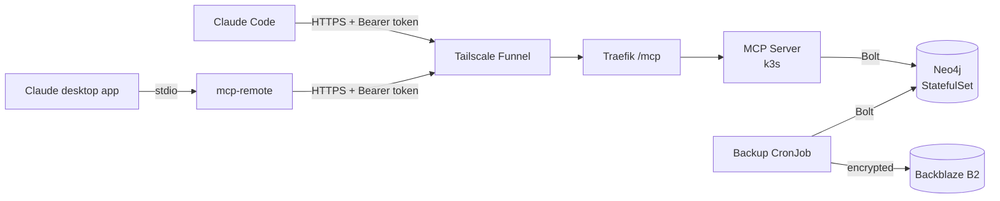

# Personal Knowledge Graph MCP Server

**English** | [한국어](README.ko.md)

An MCP server that gives Claude (claude.ai / Claude Desktop / Claude Code) long-term memory about the user, stored as a **knowledge graph**.
Projects, tech stack, decisions, career and schedule are stored as nodes and relations; the LLM queries the context it needs during a conversation and records new facts.



- **Language**: Python 3.12 + [FastMCP](https://gofastmcp.com)
- **DB**: Neo4j 5 Community
- **Deployment**: home k3s cluster ([k3s-msa-infrastructure](https://github.com/sm010422/k3s-msa-infrastructure)), ArgoCD GitOps
  - Public endpoint: `https://k3s-master.taildcdcee.ts.net/mcp` (token required)
  - CI: GitHub Actions → arm64 image → manifest tag commit → ArgoCD sync

## How it compares

| | This server | Official [`server-memory`](https://github.com/modelcontextprotocol/servers/tree/main/src/memory) | [Graphiti](https://github.com/getzep/graphiti) (Zep) | [mem0](https://github.com/mem0ai/mem0) |
|---|---|---|---|---|
| Storage | Neo4j | Local JSON file | Graph DB (Neo4j and others) | Vector store, optional graph |
| How facts get in | Claude calls explicit tools (`upsert_entity`, `add_relation`, ...) | Claude calls explicit tools | An LLM extracts them from conversation episodes | An LLM extracts them from conversations |
| Extra LLM calls / API key on write | None | None | Yes | Yes |
| When a fact changes | Old relation is closed (`validFrom`/`validTo`), changed properties kept as revisions | Overwritten | Time-bounded edges | Memory updated or deleted by the LLM |

What this server adds on top:

- **"What was true when" queries.** Relations carry validity ranges and entities keep a revision log, so "where did I work in 2025" or "when did I stop using X" can be answered, not just "what is true now".
- **Sensitive data blocked in code.** Health, financial, credential and ID-number fields are rejected by a policy check ([security.md](docs/security.md)), not only by a prompt.
- **Korean full-text search.** Fulltext indexes use Neo4j's CJK analyzer, alongside exact name/alias and substring matching.
- **Self-hosted, no extra model.** Everything runs on your own Neo4j; the only LLM is the Claude you are already talking to.

Pick something else if you want memories extracted automatically from every conversation without the assistant deciding what to save (Graphiti, mem0), or a zero-dependency single file (`server-memory`).

## Tools

| Tool | What it does |
|---|---|
| `upsert_entity` | Create or update an entity. Finds an existing one by name or alias and keeps changed properties as history |
| `add_relation` | Connect two entities. If the properties of the same relation change, the old relation is closed and a new one opened |
| `end_relation` | Mark something as "no longer true" (left a job, stopped using a technology) |
| `add_note` | Free-text observation attached to an entity |
| `get_context` | Returns the 1–2 hop subgraph around an entity as Markdown. Long notes come as a 300-char preview with their id |
| `get_note` | Full text of one note |
| `search` | Full-text search over names, aliases, summaries and notes (Korean supported) |
| `list_entities` | List by type and property filters, or only the ones untouched for N days |
| `upcoming_events` | Events dated in the next N days (deadlines, interviews), soonest first |
| `graph_stats` | Counts of entities, relations and notes |
| `merge_entities` | Fold a duplicate into another entity: relations, notes and aliases move over |
| `delete_entity` | Preview → soft delete → (when explicit) hard delete |
| `delete_note` | Preview → delete one note |

Example `get_context` output (fictional data):

```markdown
# Organization: Example Corp
- kind: company

## Relations (3)
- Person:Jordan Lee -APPLIED_TO {status: document}-> **this** (2026-10-01 ~ 2026-10-15, ended)
- Person:Jordan Lee -APPLIED_TO {status: interview}-> **this** (since 2026-10-15)
- Event:Example Corp interview -CONCERNS-> **this** (since 2026-10-19)
```

## Quick start (5 minutes)

Requirements: [Docker](https://docs.docker.com/get-docker/) and [Claude Code](https://docs.claude.com/en/docs/claude-code).

```bash
git clone https://github.com/sm010422/personal-knowledge-graph-mcp && cd personal-knowledge-graph-mcp
./scripts/quickstart.sh
```

The script writes `.env` with a random Neo4j password and MCP token (never printed), builds the server image locally (amd64 or arm64), and starts Neo4j and the MCP server on `localhost`. Then connect Claude Code from the same directory:

```bash
claude mcp add --transport http personal-kg http://localhost:8000/mcp \
  --header "Authorization: Bearer $(sed -n 's/^MCP_AUTH_TOKEN=//p' .env)"
```

Start `claude` and tell it something worth remembering ("I'm learning Rust for a CLI side project"). In a new session, ask what it knows about you.

- Data lives in a Docker volume and survives restarts. `docker compose down` stops everything; `docker compose down -v` deletes the data.
- Look at the graph in Neo4j Browser: http://localhost:7474 (user `neo4j`, password in `.env`).
- Optional fictional example data: `uv run --project server python scripts/seed_example.py`

### Connect other clients

**Claude desktop app.** The app spawns servers over stdio, so run the server with [uv](https://docs.astral.sh/uv/) straight from GitHub against the Neo4j started above. Add this to `mcpServers` in `~/Library/Application Support/Claude/claude_desktop_config.json` and restart the app with ⌘Q:

```json
"personal-kg": {
  "command": "uvx",
  "args": ["--from", "git+https://github.com/sm010422/personal-knowledge-graph-mcp#subdirectory=server", "pkg-mcp"],
  "env": {
    "NEO4J_URI": "bolt://localhost:7687",
    "NEO4J_PASSWORD": "<NEO4J_PASSWORD from .env>"
  }
}
```

If the app log says `uvx` was not found, apps do not see your shell `PATH`: use the full path from `which uvx` as `command`.

**Claude Code over stdio** (no MCP container, only Neo4j: `docker compose up -d --wait neo4j`):

```bash
claude mcp add personal-kg \
  -e NEO4J_URI=bolt://localhost:7687 -e NEO4J_PASSWORD=<NEO4J_PASSWORD from .env> \
  -- uvx --from "git+https://github.com/sm010422/personal-knowledge-graph-mcp#subdirectory=server" pkg-mcp
```

The server reads `.env` only from its working directory, and a client starts it elsewhere, so stdio setups pass the variables explicitly.

### Run it on a server

Use the same image in HTTP mode (`MCP_TRANSPORT=http`, `NEO4J_URI`, `NEO4J_PASSWORD`, `MCP_AUTH_TOKEN`) behind HTTPS, and register it with `claude mcp add --transport http <url> --header "Authorization: Bearer <token>"`. The token check is built in, but anything that can reach the URL can try tokens, so keep it long and random.

The author's setup (home k3s, ArgoCD, Tailscale Funnel, nightly encrypted backups, Claude desktop app via `mcp-remote`) is documented in [docs/deployment.md](docs/deployment.md) (in Korean).

## Development

```bash
cd server
uv run pytest                 # unit + integration (Testcontainers, needs Docker)
uv run pytest tests/unit      # without Docker
uv run ruff check . && uv run ruff format --check .
```

## Repository layout

```
server/                 MCP server (uv project)
  Dockerfile            arm64, non-root image
  src/pkg_mcp/
    server.py           tool definitions, lifespan (background DB connect), probes, stdio/http entry points
    auth.py             Bearer token check in HTTP mode
    repository.py       Cypher layer — entity resolution, history, search
    schema.py           entity/relation vocabulary, relation direction rules, return models
    policy.py           blocks storing sensitive information
    formatting.py       get_context → Markdown
    db.py, config.py    driver, constraints/indexes, settings
    backup.py           pkg-mcp-backup: export/restore of the whole graph
    observability.py    Sentry error reporting (only when SENTRY_DSN is set, personal data stripped)
  tests/unit, tests/integration
docs/
  architecture.md  schema.md  security.md
  adr/              architecture decision records
  devlog/           progress log
k8s/                    cluster manifests (synced by ArgoCD)
  neo4j.yaml  mcp-server.yaml  ingress.yaml  networkpolicy.yaml  kustomization.yaml
  backup-cronjob.yaml   daily encrypted backup → Backblaze B2
  secret.example.yaml   template only — the real Secret is created with kubectl
  cloudflare-tunnel/    inactive, to switch to once there is a domain
.github/workflows/ci.yml  test → arm64 build → tag commit
scripts/seed_example.py   fictional example data
scripts/*backup*.sh       create backup Secret, local rclone setup
scripts/create-sentry-secret.sh  create Sentry DSN Secret
docker-compose.yml        local Neo4j + MCP server (HTTP)
scripts/quickstart.sh     generate .env and start docker compose
```

## Docs

The documents under `docs/` are written in Korean.

- [Architecture](docs/architecture.md) · [Request flow diagrams](docs/request-flow.md) · [Graph schema](docs/schema.md) · [Security & privacy policy](docs/security.md) · [Sentry/Istio/Kiali review](docs/observability-sentry-istio-kiali.md)
- [TODO & notes](docs/TODO.md) — current state, caveats, prioritized to-dos
- [Deployment & operations guide](docs/deployment.md) — k3s setup, CI, token rotation, rollback, incident response
- [ADR index](docs/adr/README.md)
- Devlog: [Phase 1 start](docs/devlog/2026-10-19-phase1-bootstrap.md) · [Phase 2 k3s deployment](docs/devlog/2026-10-19-phase2-k3s-deployment.md) · [Backup & first use](docs/devlog/2026-10-27-backup-and-first-use.md) · [Search AND/OR/NOT bug fix](docs/devlog/2026-11-02-lucene-operator-search-bug.md) · [Public polish & first graph audit](docs/devlog/2026-11-02-public-polish-and-first-graph-audit.md) · [Context cost, events & cleanup tools](docs/devlog/2026-11-05-context-cost-events-and-maintenance-tools.md) · [General-purpose review](docs/devlog/2026-11-05-general-purpose-review.md)

## Roadmap

1. **Phase 1** — local: docker-compose + stdio mode + core tools + integration tests ✅
2. **Phase 2** — HTTP mode + token auth + k3s deployment + public exposure ✅
   - Exposed through Tailscale Funnel. Cloudflare Tunnel is prepared but not active ([ADR-0009](docs/adr/0009-expose-via-tailscale-funnel.md)).
3. Phase 3 — backup CronJob ✅ ([ADR-0011](docs/adr/0011-logical-backup-to-b2.md)), Sentry error reporting ✅ (waiting for DSN), Prometheus metrics (tool call count/latency/errors), Grafana dashboard
4. Phase 4 — LLM extraction of entities/relations from conversation text, temporal queries

## Privacy

Real personal data, DB dumps and seed data are never committed. All examples and test data use fictional people. Health, financial, credential and ID-number information is not stored, and the code blocks it ([security.md](docs/security.md)).

## License

[MIT](LICENSE)
