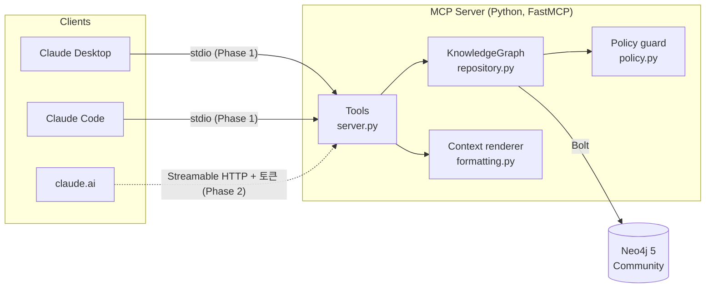

# 아키텍처

## 전체 구성

## 계층

| 계층 | 파일 | 책임 |
|---|---|---|
| 툴 | `server.py` | MCP 툴 시그니처와 description, 도메인 에러 → `ToolError` 변환, lifespan(드라이버 생성·스키마 부트스트랩·종료) |
| 도메인/저장소 | `repository.py` | 엔티티 해석(이름·alias·`Type:` 접두사), 이력 관리, Cypher 실행. 모든 쓰기는 하나의 트랜잭션 함수 안에서 끝난다 |
| 어휘 | `schema.py` | EntityType / RelationType enum, 관계 허용 규칙, 반환 모델 |
| 정책 | `policy.py` | 민감정보 키·값 패턴 차단 |
| 표현 | `formatting.py` | `get_context` 결과를 LLM이 읽기 좋은 Markdown으로 변환 |
| 인프라 | `db.py`, `config.py` | 드라이버 생성, 제약/인덱스(멱등), 환경변수 설정 |

툴 함수는 얇게 유지하고 로직은 `KnowledgeGraph`에 둔다. 그래서 통합 테스트 대부분은 MCP 프로토콜을 거치지 않고 저장소를 직접 호출하고, 프로토콜 경로는 `test_mcp_server.py`가 in-memory 클라이언트로 따로 검증한다.

## 요청 흐름 예: `add_relation("Alex", APPLIED_TO, "Acme", {status: "interview"})`

1. FastMCP가 인자를 Pydantic으로 검증한다(`relation_type`은 enum이라 오타가 여기서 걸린다).
2. `validate_properties` → 키 형식, 예약어, 저장 가능한 타입, 민감정보 정책을 확인한다.
3. 쓰기 트랜잭션 안에서:
   - 양쪽 엔티티를 이름·alias로 해석한다. 없으면 "upsert_entity 먼저", 여럿이면 "타입을 붙여라"라는 에러를 낸다.
   - `RELATION_RULES`로 (Person → Organization)이 허용되는지 확인한다.
   - 현재 유효한(`validTo IS NULL`) 같은 타입의 관계를 찾는다. 속성이 같으면 `unchanged`, 다르면 기존 관계를 닫고 새 관계를 연다(`superseded`).
4. 결과를 구조화된 JSON으로 반환한다.

## 전송 방식

- **Phase 1 — stdio**: Claude Desktop/Code가 서버를 자식 프로세스로 띄운다. 네트워크에 열리는 포트가 없으므로 인증이 필요 없다. 이 때문에 `docker-compose.yml`에는 Neo4j만 있다. 서버를 컨테이너로 띄우면 클라이언트가 stdio로 붙을 수 없기 때문이다.
- **Phase 2 — Streamable HTTP**: 같은 `create_server()`를 `run(transport="http")`로 띄우고 Bearer 토큰 인증을 붙인다. k3s에 배포하고 Cloudflare Tunnel로 노출한다.

## 운영 관련 결정

- **스키마 부트스트랩**: 서버 시작 시 `CREATE ... IF NOT EXISTS`로 제약과 인덱스를 만든다. 별도 마이그레이션 도구 없이 멱등하게 동작한다.
- **Neo4j 알림 끄기**: `deletedAt`처럼 선택적 속성을 쓰면 Neo4j가 쿼리마다 "property does not exist" 경고를 보낸다. stdio 모드에서는 이게 MCP 클라이언트 로그를 덮으므로 드라이버에서 `notifications_min_severity="OFF"`로 끈다.
- **전문 검색 분석기 `cjk`**: 한국어를 bigram으로 쪼개서 "궤도 추적"이 "위성 궤도 추적 서비스"에 걸린다. 라틴 문자는 소문자화되며, 영문 단어에는 `kube*` 같은 접두 와일드카드를 덧붙인다.
