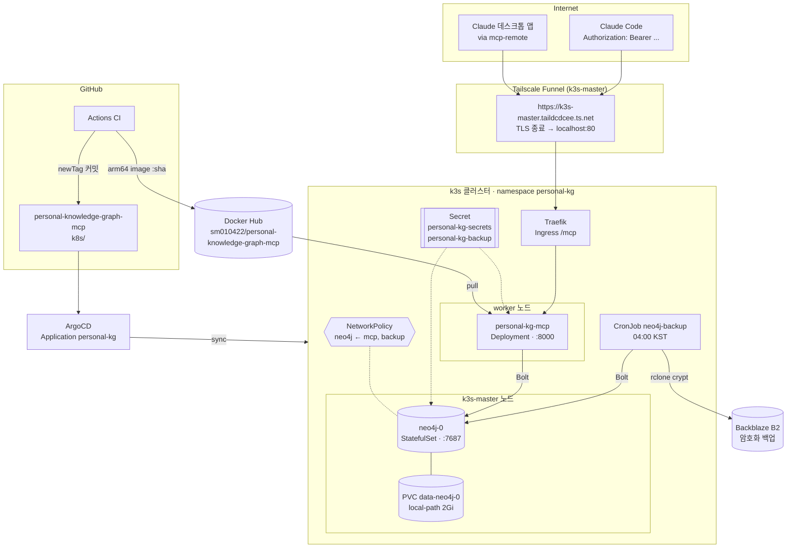

# 배포 · 운영 가이드 (Phase 2)

홈 k3s 클러스터에 MCP 서버와 Neo4j를 배포하고, 인터넷에서 토큰으로 접근하게 만든 구성과 운영 절차다. 진행 과정과 겪은 문제는 devlog([Phase 2](devlog/2026-10-19-phase2-k3s-deployment.md), [백업·첫 사용](devlog/2026-10-27-backup-and-first-use.md))에 따로 있다. 요청이 흐르는 경로는 [request-flow.md](request-flow.md)에 있다.

## 전체 구성



## 1. HTTP 모드 + 토큰 인증

같은 코드가 환경변수로 두 모드를 오간다.

| 환경변수 | stdio (로컬) | http (클러스터) |
|---|---|---|
| `MCP_TRANSPORT` | `stdio` (기본) | `http` (이미지 기본값) |
| `MCP_HOST` / `MCP_PORT` / `MCP_PATH` | 무시 | `0.0.0.0` / `8000` / `/mcp` |
| `MCP_AUTH_TOKEN` | 무시 | **필수**, 32자 이상 |
| `MCP_AUTH_TOKEN_NEXT` | 무시 | 선택, 교체 중에만 |

HTTP 모드의 엔드포인트:

| 경로 | 인증 | 용도 |
|---|---|---|
| `POST /mcp` | Bearer 토큰 | MCP Streamable HTTP. stateless 모드라 어느 레플리카든 응답할 수 있고, 파드가 재시작돼도 클라이언트 세션이 깨지지 않는다 |
| `GET /health` | 없음 | liveness. 프로세스가 살아 있는지만 본다 |
| `GET /ready` | 없음 | readiness. Neo4j 연결과 스키마 준비가 끝나야 200 |

- **인증 방식**: [ADR-0007](adr/0007-bearer-token-auth.md). 상수 시간 비교, 토큰 2개 동시 허용.
- **DB 연결**: 시작을 막지 않는다. 백그라운드에서 재시도하는 이유는 [ADR-0010](adr/0010-background-db-connect.md).
- **Host 헤더 검사**: `0.0.0.0`으로 바인딩하면 FastMCP의 Host 헤더 검사(DNS rebinding 방어)가 꺼진다. 그래서 Ingress나 Funnel을 거쳐 `k3s-master.taildcdcee.ts.net` Host로 들어와도 421로 막히지 않는다(통합 테스트 `test_public_host_header_is_accepted`). DNS rebinding은 인증 없는 로컬 서버를 노리는 공격이라, 토큰 인증이 필수인 이 서버에는 해당되지 않는다.

로컬에서 HTTP 모드로 띄워 보기:

```bash
cd server
MCP_TRANSPORT=http MCP_AUTH_TOKEN=$(openssl rand -hex 32) NEO4J_PASSWORD=... uv run pkg-mcp
```

## 2. 컨테이너 이미지와 CI

### 이미지 (`server/Dockerfile`)

- **멀티 스테이지**: uv로 의존성과 프로젝트를 `.venv`에 설치한 뒤, 런타임 스테이지(`python:3.12-slim`)에는 `.venv`만 복사한다. 의존성 레이어를 먼저 만들어서, 코드만 바뀌면 그 레이어를 재사용한다.
- **비root 실행**: uid 10001 사용자로 실행한다. 읽기 전용 루트 파일시스템, 모든 capability 제거 상태에서 동작하는 것을 로컬에서 확인했다(`docker run --read-only --cap-drop ALL --security-opt no-new-privileges`).
- **아키텍처**: `linux/arm64`. 클러스터 노드가 Apple Silicon 위의 Multipass VM이다.
- **실측 메모리**: 약 95~106MiB.

### CI (`.github/workflows/ci.yml`)

```
push(main, server/**) ─▶ test ─▶ build (ubuntu-24.04-arm) ─▶ deploy
                         │        │                           │
                         │        └ Docker Hub :<sha>, :latest │
                         └ ruff check / format --check          └ k8s/kustomization.yaml newTag=<sha>
                           pytest (Testcontainers Neo4j 포함)      커밋 "[skip ci]" → ArgoCD sync
```

- PR에서는 test만 돈다.
- 이미지 태그는 항상 전체 커밋 SHA다. 왜 Image Updater를 쓰지 않는지는 [ADR-0008](adr/0008-image-delivery-by-manifest-commit.md).

**필요한 GitHub Secrets**

| 이름 | 값 | 상태 |
|---|---|---|
| `DOCKERHUB_USERNAME` | `sm010422` | 설정됨 |
| `DOCKERHUB_TOKEN` | Docker Hub → Account settings → Personal access tokens (Read & Write) | **사용자가 설정해야 함** |

```bash
gh secret set DOCKERHUB_TOKEN -R sm010422/personal-knowledge-graph-mcp   # 프롬프트에 토큰 붙여넣기
gh workflow run CI -R sm010422/personal-knowledge-graph-mcp              # 재실행해서 전체 파이프라인 확인
```

토큰이 설정되기 전까지는 build job이 `Username and password required`로 실패한다. 그동안은 아래처럼 수동으로 배포한다. CI와 같은 태그 규칙이다.

```bash
SHA=$(git rev-parse HEAD); IMG=sm010422/personal-knowledge-graph-mcp
docker build -t $IMG:$SHA server && docker push $IMG:$SHA
sed -i '' -E "s/^( *newTag:).*/\1 \"$SHA\"/" k8s/kustomization.yaml
git commit -am "chore(deploy): pin image ${SHA:0:7}" && git push
```

## 3. Kubernetes 매니페스트 (`k8s/`)

| 파일 | 리소스 | 핵심 설정 |
|---|---|---|
| `namespace.yaml` | Namespace `personal-kg` | |
| `neo4j.yaml` | headless Service + StatefulSet | k3s-master 고정(nodeAffinity + master taint toleration). heap 384m + pagecache 128m, request 768Mi / limit 1Gi. HTTP(7474) 비활성, Bolt만. 사용 통계 전송 끔. PVC 2Gi local-path |
| `mcp-server.yaml` | Service + Deployment | request 128Mi / limit 256Mi. `runAsNonRoot`, `readOnlyRootFilesystem`, capability 전부 제거, seccomp RuntimeDefault. readiness `/ready`, liveness `/health` |
| `ingress.yaml` | Ingress (traefik) | `/mcp` Prefix만 라우팅 |
| `networkpolicy.yaml` | NetworkPolicy | Neo4j 7687은 `app=personal-kg-mcp` 파드에서만 접근 가능 |
| `kustomization.yaml` | — | 이미지 태그 고정(CI가 갱신) |
| `secret.example.yaml` | — | **템플릿만**. kustomization에 없음 |
| `cloudflare-tunnel/` | — | **비활성**. 전환 대비 ([README](../k8s/cloudflare-tunnel/README.md)) |

### 노드 배치 근거

기존 C4I 앱을 내린 뒤 노드 메모리는 master 46%, worker1 39%, worker2 57%였다(master 약 2.9GiB, worker 1.5~1.75GiB). Neo4j가 제일 크다(실측 약 630~670MiB). 그래서 여유가 가장 큰 master에 고정했다. 이 배치는 기존 gitnexus가 master에 있던 방식과 같다. local-path 볼륨은 처음 생성된 노드에 묶이므로, 고정해 두지 않으면 나중에 다른 노드로 옮겨갈 수 없다.

배포 후 실측(2026-10-19):

| 노드 | 메모리 | 이 프로젝트 파드 |
|---|---|---|
| k3s-master | 1981Mi (67%) | neo4j-0 — 669Mi |
| k3s-worker1 | 757Mi (52%) | personal-kg-mcp — 106Mi |
| k3s-worker2 | 918Mi (53%) | — |

### Secret 생성 (최초 1회)

값은 git에 넣지 않는다. 랜덤으로 만들고 클러스터에만 둔다.

```bash
kubectl create namespace personal-kg
NEO4J_PASSWORD=$(openssl rand -hex 24)
MCP_AUTH_TOKEN=$(openssl rand -hex 32)
kubectl create secret generic personal-kg-secrets -n personal-kg \
  --from-literal=NEO4J_PASSWORD="$NEO4J_PASSWORD" \
  --from-literal=NEO4J_AUTH="neo4j/$NEO4J_PASSWORD" \
  --from-literal=MCP_AUTH_TOKEN="$MCP_AUTH_TOKEN"

# 클라이언트 연결용으로 로컬에만 보관 (.env.* 는 git-ignored, 권한 600)
umask 077; printf 'MCP_URL=https://k3s-master.taildcdcee.ts.net/mcp\nMCP_AUTH_TOKEN=%s\n' "$MCP_AUTH_TOKEN" > .env.remote
```

`NEO4J_AUTH`는 Neo4j 이미지가 요구하는 `neo4j/<password>` 형식이다. `NEO4J_PASSWORD`와 같은 값이어야 한다.

> 주의: Neo4j는 `NEO4J_AUTH`를 **데이터 디렉터리가 비어 있을 때 한 번만** 적용한다. PVC가 생긴 뒤에 Secret의 비밀번호만 바꾸면, 서버는 새 비밀번호로 접속을 시도하고 실패한다. 비밀번호를 바꾸려면 Neo4j 안에서 `ALTER USER`를 먼저 실행해야 한다(아래 운영 절차).

## 4. ArgoCD 등록

Application은 인프라 레포에 있다: `k3s-msa-infrastructure/argocd/applications/personal-kg.yaml`

- source: 이 레포의 `main` 브랜치, `k8s/` 경로. public 레포라 ArgoCD에 별도 자격증명이 필요 없다.
- `automated: {prune: true, selfHeal: true}`, `CreateNamespace=true`. 기존 앱들과 같은 정책이다.
- 이 레포의 다른 Application들처럼 `kubectl apply -f`로 한 번 등록한다. 이후 변경은 git push만 하면 된다.

```bash
kubectl apply -f argocd/applications/personal-kg.yaml      # k3s-msa-infrastructure에서
kubectl get application personal-kg -n argocd             # Synced / Healthy
```

## 5. 외부 노출 (Tailscale Funnel)

```
https://k3s-master.taildcdcee.ts.net/mcp
  └ Funnel(k3s-master tailscaled, TLS) → localhost:80 → Traefik → Ingress /mcp → Service :8000
```

- 새로 켠 것은 없다. 기존 Funnel이 Traefik 80번을 공개하고 있었고, 거기에 Ingress `/mcp` 규칙만 추가했다.
- **Funnel은 Traefik 전체를 공개한다.** 이 클러스터에 Ingress를 추가하면 그 경로도 인터넷에 열린다. 그래서 MCP 서버는 자체 토큰 인증을 필수로 하고 `/mcp`만 연다.
- 왜 Cloudflare Tunnel이 아닌지, 전환 방법은 [ADR-0009](adr/0009-expose-via-tailscale-funnel.md)와 [cloudflare-tunnel/README.md](../k8s/cloudflare-tunnel/README.md)에 있다.

### 클라이언트 연결

**Claude Code** (원격 HTTP):

```bash
source .env.remote
claude mcp add --transport http personal-kg "$MCP_URL" \
  --header "Authorization: Bearer $MCP_AUTH_TOKEN"
```

**claude.ai / Claude Desktop 커넥터**: 커스텀 커넥터는 OAuth 흐름을 기대해서 고정 Bearer 토큰으로는 붙지 않는다. Desktop은 로컬 stdio 모드로 연결한다(README). 원격 연결은 OAuth 도입 후 가능하다(ADR-0007).

## 검증 (2026-10-19 실측)

```bash
source .env.remote
H='-H Content-Type:application/json -H Accept:application/json,text/event-stream'
curl -s -o /dev/null -w '%{http_code}\n' -X POST $MCP_URL $H -d '{"jsonrpc":"2.0","id":1,"method":"tools/list"}'                              # 401
curl -s -o /dev/null -w '%{http_code}\n' -X POST $MCP_URL $H -H 'Authorization: Bearer nope' -d '{"jsonrpc":"2.0","id":1,"method":"tools/list"}'  # 401
```

| 항목 | 결과 |
|---|---|
| 공개 URL, 토큰 없음 / 틀린 토큰 | 401 / 401 |
| 공개 URL, 올바른 토큰 (FastMCP 클라이언트) | 툴 8개, upsert → get_context → hard delete 왕복 성공 |
| 공개 URL `/health` | 라우팅 안 됨 (Ingress가 `/mcp`만) |
| 공개 URL `:7687` | 연결 안 됨 |
| 다른 namespace 파드 → `neo4j:7687` | 차단 (NetworkPolicy) |
| 같은 namespace, 다른 라벨 파드 → `neo4j:7687` | 차단 |
| MCP 파드 → `neo4j:7687` | 허용 |
| Neo4j 파드 삭제 | Neo4j 19초 만에 복귀, MCP 재시작 0회 |
| Neo4j·MCP 동시 삭제 | 39초 만에 정상화, MCP 재시작 0회 |

## 운영 절차

### 토큰 교체

`MCP_AUTH_TOKEN_NEXT`를 이용해 무중단으로 교체한다.

```bash
NEW=$(openssl rand -hex 32)
# 1) 새 토큰을 NEXT로 추가 → 두 토큰 모두 유효
kubectl patch secret personal-kg-secrets -n personal-kg --type merge -p "{\"stringData\":{\"MCP_AUTH_TOKEN_NEXT\":\"$NEW\"}}"
kubectl rollout restart deploy/personal-kg-mcp -n personal-kg
# 2) 클라이언트들을 새 토큰으로 변경 (claude mcp remove/add, .env.remote)
# 3) 새 토큰을 기본으로 올리고 NEXT 제거
kubectl patch secret personal-kg-secrets -n personal-kg --type merge -p "{\"stringData\":{\"MCP_AUTH_TOKEN\":\"$NEW\"}}"
kubectl patch secret personal-kg-secrets -n personal-kg --type json -p '[{"op":"remove","path":"/data/MCP_AUTH_TOKEN_NEXT"}]'
kubectl rollout restart deploy/personal-kg-mcp -n personal-kg
```

### Neo4j 비밀번호 변경

```bash
OLD=$(kubectl get secret personal-kg-secrets -n personal-kg -o jsonpath='{.data.NEO4J_PASSWORD}' | base64 -d)
NEW=$(openssl rand -hex 24)
kubectl exec -n personal-kg neo4j-0 -- cypher-shell -u neo4j -p "$OLD" -d system "ALTER CURRENT USER SET PASSWORD FROM '$OLD' TO '$NEW'"
kubectl patch secret personal-kg-secrets -n personal-kg --type merge \
  -p "{\"stringData\":{\"NEO4J_PASSWORD\":\"$NEW\",\"NEO4J_AUTH\":\"neo4j/$NEW\"}}"
kubectl rollout restart deploy/personal-kg-mcp -n personal-kg
```

### 롤백

`k8s/kustomization.yaml`의 `newTag`를 이전 SHA로 되돌리고 push한다. ArgoCD가 이전 이미지로 바꾼다.

```bash
git log --oneline -- k8s/kustomization.yaml     # 이전 배포 SHA 찾기
```

### 일시 중지 / 재개

데이터(PVC)와 Secret은 남기고 워크로드만 내린다. 기존 C4I 앱을 내린 방식과 같다.

```bash
# 일시 중지: neo4j.yaml, mcp-server.yaml 의 replicas 를 0 으로 커밋
# 재개: 해당 커밋 revert
```

ArgoCD Application을 지우면 `prune: true` 때문에 PVC까지 지워질 수 있다. 내리고 싶을 때는 Application을 지우지 말 것.

### 그래프 보기 (Neo4j Browser)

DB를 외부에 열지 않고 port-forward로만 본다. `scripts/graph-browser.sh`가 터널을 열고 Neo4j 비밀번호를 클립보드에 복사한다.

```bash
scripts/graph-browser.sh            # 이후 https://browser.neo4j.io 에서 bolt://localhost:7687 로 접속 (neo4j:// 는 라우팅 때문에 실패)
```

여기서는 조회만 한다. Browser에서 직접 쓰면 MCP 서버의 검증(관계 규칙, 민감정보 차단)과 이력(Revision)을 건너뛴다.

### 백업과 복구

매일 04:00 KST에 CronJob `neo4j-backup`이 그래프 전체를 덤프한다. rclone crypt로 암호화한 뒤 Backblaze B2 버킷의 `neo4j/` 아래에 올리고, 30일 넘은 백업은 지운다. 결정 근거는 [ADR-0011](adr/0011-logical-backup-to-b2.md)에 있다.

**최초 설정 (1회)**

1. B2에서 Private 버킷과 그 버킷 전용 앱 키(Read and Write)를 만든다.
2. 레포 루트의 `.env.backup`(git 제외)에 `S3_ENDPOINT`, `S3_BUCKET`, `S3_ACCESS_KEY_ID`(keyID), `S3_SECRET_ACCESS_KEY`(applicationKey)를 적는다.
3. `scripts/create-backup-secret.sh`를 실행한다. 처음 실행하면 `BACKUP_PASSPHRASE`를 만들어 `.env.backup`에 추가하고, Secret `personal-kg-backup`을 만든다.
4. **`BACKUP_PASSPHRASE`를 비밀번호 관리자에 복사한다.** 이 문구가 없으면 백업을 풀 수 없다. 이 Mac과 클러스터를 동시에 잃는 경우를 대비해야 한다.

**수동 실행과 확인**

```bash
kubectl create job -n personal-kg --from=cronjob/neo4j-backup neo4j-backup-manual-$(date +%s)
kubectl logs -n personal-kg job/<위 이름> -c export   # "export ok: N nodes, M relationships"
kubectl logs -n personal-kg job/<위 이름> -c upload

source scripts/backup-rclone-env.sh
rclone ls backup:                                       # 이름은 타임스탬프뿐
```

**복구** (빈 Neo4j에만 복원된다. 데이터가 있으면 거부한다)

```bash
source scripts/backup-rclone-env.sh
rclone copy backup:neo4j-<ts>.jsonl.gz backups/         # 내려받으면서 복호화. backups/ 는 git 제외

kubectl port-forward -n personal-kg neo4j-0 17687:7687 &
cd server
NEO4J_URI=bolt://localhost:17687 \
NEO4J_PASSWORD="$(kubectl get secret personal-kg-secrets -n personal-kg -o jsonpath='{.data.NEO4J_PASSWORD}' | base64 -d)" \
  uv run pkg-mcp-backup restore ../backups/neo4j-<ts>.jsonl.gz   # "restore ok: N nodes, M relationships"
```

복원이 끝나면 `backups/` 아래 파일을 지운다(평문 개인 데이터다).

**복구 리허설**은 클러스터 대신 로컬의 일회용 Neo4j에 복원해서 확인한다.

```bash
docker run --rm -d --name pkg-restore-rehearsal -p 17687:7687 -e NEO4J_AUTH=neo4j/rehearsal-pass neo4j:5-community
cd server && NEO4J_URI=bolt://localhost:17687 NEO4J_PASSWORD=rehearsal-pass \
  uv run pkg-mcp-backup restore ../backups/neo4j-<ts>.jsonl.gz
# 개수가 export 로그와 같은지, get_context 결과가 클러스터와 같은지 비교
docker rm -f pkg-restore-rehearsal && rm ../backups/neo4j-<ts>.jsonl.gz
```

## 장애 대응

| 증상 | 확인 | 원인 / 조치 |
|---|---|---|
| 클라이언트 401 | `.env.remote` 토큰과 Secret 비교 | 토큰 불일치, 또는 교체 중 `NEXT`만 바꾸고 재시작 안 함 |
| 클라이언트 404 | `kubectl get ingress -n personal-kg` | 경로가 `/mcp`가 아님 (`/mcp/` 아님, 정확히 `/mcp`) |
| 클라이언트 연결 자체 실패 | `curl https://k3s-master.taildcdcee.ts.net/` | Funnel 꺼짐 또는 k3s-master 다운. 노드에서 `sudo tailscale funnel status` |
| 툴이 "not reachable yet" 에러 | `kubectl get pods -n personal-kg`, `kubectl logs deploy/personal-kg-mcp` | Neo4j가 아직 안 뜸. 로그의 `Neo4j not ready (attempt N)` 사유 확인 |
| MCP 파드 Ready 안 됨 | `kubectl logs -n personal-kg deploy/personal-kg-mcp \| grep "not ready"` | `/ready` 503 → Neo4j 연결 실패. `AuthError`면 비밀번호 불일치(위 주의 참고) |
| neo4j-0 Pending | `kubectl describe pod neo4j-0 -n personal-kg` | k3s-master 메모리 부족. 다른 워크로드 확인 |
| neo4j-0 OOMKilled | `kubectl describe pod` → Last State | heap + pagecache + 오버헤드가 1Gi 초과. pagecache를 먼저 줄인다 |
| ArgoCD OutOfSync 반복 | `kubectl get application personal-kg -n argocd -o yaml` | 수동으로 바꾼 필드(selfHeal이 되돌림). git에서 바꿀 것 |
