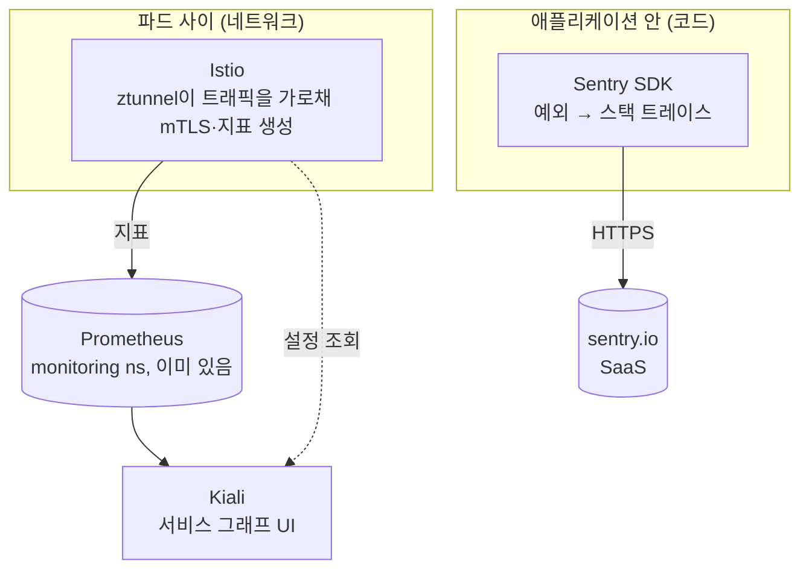

# Sentry · Istio · Kiali 검토

세 도구가 각각 무엇을 보여 주는지, 이 프로젝트와 홈 클러스터에 맞는지 정리한다. 결론부터 적는다.

| 도구 | 보는 것 | 결정 (2026-10-28) |
|---|---|---|
| **Sentry** | 코드 안에서 예상 못 한 예외 (어느 파일·줄에서 터졌나) | **도입.** SaaS 무료 플랜이라 클러스터 메모리를 쓰지 않는다. 코드는 들어갔고 DSN만 넣으면 켜진다 |
| **Istio** (ambient) | 파드 사이 네트워크: mTLS, L4/L7 트래픽 | **보류.** 예상 메모리 300~450Mi. 노드 여유에 비해 크다 |
| **Kiali** | Istio가 수집한 트래픽을 실시간 그래프로 | **보류.** Istio 없이는 그릴 데이터가 없다 |

## 셋의 관계



- **Sentry는 코드 안**, **Istio는 네트워크**를 본다. 서로 대체하지 않는다. Sentry는 "어느 줄에서 왜 터졌나", Istio·Kiali는 "누가 누구를 얼마나 부르고, 얼마나 실패하나"를 보여 준다.
- Kiali는 Istio의 UI다. 데이터는 Istio가 만들고 Prometheus가 저장한다. Kiali만 따로 설치하면 빈 화면이다.

## Sentry

### 이 프로젝트에서 쓰는 이유

- 툴이 예상 못 한 예외로 실패하면, 지금은 Claude 쪽에 "Error calling tool"만 보이고 원인은 파드 로그를 직접 뒤져야 한다. 파드가 재시작되면 로그도 사라진다.
- 백업 CronJob이 실패해도 알림이 없다(TODO 7-1). Sentry가 export 단계의 예외를 받는다.

### 무엇을 보내고 무엇을 안 보내나

그래프에는 지원 현황, 경력 같은 개인 데이터가 있다. 그래서 **어디서 실패했는지만** 보낸다. 구현은 `server/src/pkg_mcp/observability.py`다.

| 보냄 | 안 보냄 (이유) |
|---|---|
| 예외 타입 (`ServiceUnavailable`, `KeyError` …) | 예외 메시지: Neo4j 제약 위반 메시지는 속성 값을 그대로 담는다 |
| 스택 프레임 (파일, 함수, 줄 번호) | 프레임 지역 변수, 소스 코드 줄 |
| 태그 `component` (server/backup), environment | 툴 인자: SDK의 MCP 통합은 인자를 span에 **무조건** 기록한다 → 통합을 끄고 tracing도 끈다 |
| 요청 method, URL (`POST /mcp`) | 요청 본문, 헤더(Authorization 포함), 쿼리 |
| | 로그 줄, breadcrumb: FastMCP 로그가 인자를 담을 수 있다 |

이중으로 막는다.
1. SDK가 애초에 덜 모으게 한다: `data_collection`(user_info, 헤더·본문·쿼리·프레임 변수 off), `max_breadcrumbs=0`, `traces_sample_rate=None`, `MCPIntegration` 비활성, 로깅 통합 off.
2. 그래도 남은 것을 `before_send`(`scrub_event`)가 지운다.

테스트(`tests/unit/test_observability.py`)는 실제 SDK에 가짜 전송 계층을 끼워 둔다. 툴 인자와 예외 메시지, 지역 변수에 넣은 값이 전송 데이터 어디에도 없는지 확인한다. 로그 줄로 흘린 값도 같이 확인한다.

### 무엇을 보고하나

- **보고함**: 툴 안에서 `KnowledgeGraphError`가 아닌 예외(버그, Neo4j 연결 끊김 같은 인프라 실패). `server.py`의 `call()`에서 잡아 보낸 뒤 그대로 다시 던진다. 클라이언트는 전과 같이 툴 에러를 받는다.
- **보고 안 함**: 입력 검증 실패, "upsert_entity 먼저", 관계 방향 위반, DB 기동 중. 이건 모델이 읽고 다시 호출하라고 돌려주는 정상 흐름이다.
- 백업: `pkg-mcp-backup` 안에서 잡히지 않은 예외를 SDK가 받는다. `BackupError`(빈 DB 아님, 잘린 파일)는 Job 실패로만 남는다.

### 켜는 방법

1. sentry.io 가입 → 프로젝트 생성(플랫폼 Python) → DSN 복사
2. 저장소 루트에 `.env.sentry` 파일 한 줄(git-ignored): `SENTRY_DSN=https://...`
3. `scripts/create-sentry-secret.sh`: Secret `personal-kg-sentry`를 만들고 서버를 재시작한다
4. 확인용 이벤트 하나 보내기:

```bash
kubectl exec -n personal-kg deploy/personal-kg-mcp -- python -c "
import sentry_sdk
from pkg_mcp.config import Settings
from pkg_mcp.observability import init_sentry, report_unexpected
init_sentry(Settings(), 'smoke-test'); report_unexpected(RuntimeError('x')); sentry_sdk.flush()"
```

Sentry 화면에 `RuntimeError`가 메시지 없이 뜨면 정상이다. 메시지는 일부러 지운다.

Secret이 없으면 매니페스트의 `optional: true` 때문에 환경변수가 비고, SDK는 시작하지 않는다. DSN을 넣기 전에 배포해도 아무 일도 없다.

### 다음 단계

- **Sentry Crons**: 백업 Job이 04:00에 아예 안 돌았거나 업로드(rclone) 단계에서 실패한 것도 잡으려면 Job 시작·끝에 체크인을 보낸다. 지금은 export 단계의 예외만 잡힌다.
- 알림 규칙: 새 이슈가 생기면 메일. 무료 플랜 한도(월 5천 에러)는 개인 사용량으로는 충분하다.

## Istio와 Kiali: 왜 보류했나

### 하려던 구성

- **ambient 모드**: 파드마다 sidecar를 붙이지 않고, 노드마다 `ztunnel` 하나가 L4(mTLS, TCP 지표)를 처리한다. sidecar 모드보다 훨씬 가볍다.
- k3s용 경로(`global.platform: k3s`)는 차트가 지원한다. 이 클러스터에는 Traefik이 설치한 Gateway API CRD(v1.5.1)가 이미 있다.
- Kiali는 이미 있는 Prometheus(`monitoring` ns)를 데이터 소스로 쓰고, anonymous + view-only로 두고 port-forward로만 연다.
- 차트 버전은 Istio 1.30.7, kiali-server 2.34.0이었다(2026-10-28 기준 최신).

### 메모리 계산

차트 기본값 그대로는 **아예 뜨지 않는다.** istiod 하나가 메모리 2Gi, ztunnel이 노드마다 512Mi를 요청하는데, worker1의 할당 가능 메모리는 전부 합쳐 1.42Gi다. 그래서 요청값을 줄여서 렌더링해 봤다(`helm template`).

| 구성 요소 | 개수 | 요청(줄인 값) | 예상 실사용 |
|---|---|---|---|
| istiod | 1 | 128Mi | 80~150Mi |
| istio-cni-node | 노드마다 3 | 40Mi × 3 | 25~40Mi × 3 |
| ztunnel | 노드마다 3 | 32Mi × 3 | 15~30Mi × 3 |
| Kiali | 1 | 64Mi | 50~100Mi |
| Prometheus 증가분 | — | — | 30~60Mi (새 시계열) |
| **합계** | | **약 410Mi** | **약 300~450Mi** |

예상 실사용은 소규모 클러스터에서 흔히 보이는 범위를 적은 추정치다. 실측한 값이 아니다.

지금 노드 여유(2026-10-28 `kubectl top`):

| 노드 | 할당 가능 | 사용 중 | 여유 |
|---|---|---|---|
| k3s-master | 2.9Gi | 2043Mi (69%) | 약 950Mi |
| k3s-worker1 | 1.42Gi | 815Mi (56%) | 약 640Mi |
| k3s-worker2 | 1.66Gi | 828Mi (48%) | 약 880Mi |

전체 여유의 15~20%를 메시가 가져간다. 게다가 이건 L4만 쓸 때 숫자다. Kiali에서 HTTP 응답 코드와 지연까지 보려면 namespace마다 waypoint(Envoy)를 하나 더 띄워야 하고, 그러면 50~100Mi가 더 든다. 서비스 2개짜리 프로젝트가 얻는 것에 비해 비용이 크다고 보고 보류했다.

### 나중에 다시 할 때 걸리는 점

메모리가 늘거나 노드가 추가되면 다시 검토한다. 그때 놓치기 쉬운 것들:

- **NetworkPolicy**: ambient에서는 파드 사이 연결이 HBONE(포트 15008)으로 바뀐다. 지금 `neo4j-from-mcp-only`는 7687만 열어 두었으므로 **15008도 같은 출발지로 열어야** MCP 서버 → Neo4j가 끊기지 않는다. kubelet 프로브는 출발지가 `169.254.7.127`로 바뀌므로 그 주소도 허용해야 한다.
- **ArgoCD**: istiod가 `ValidatingWebhookConfiguration`의 `failurePolicy`를 바꾸므로 `ignoreDifferences` 없이는 OutOfSync가 반복된다.
- **Traefik은 메시 밖**이다. Funnel → Traefik → MCP 서버 구간은 평문으로 들어오고(PERMISSIVE), Kiali에는 출발지가 `unknown`으로 보인다.
- **CronJob**: sidecar 모드에서는 Job이 끝나도 sidecar가 남아 Job이 안 끝나는 문제가 있다. ambient는 이 문제가 없다. 이것도 ambient를 고른 이유였다.
- Prometheus에 ztunnel(`:15020/metrics`)과 istiod(`:15014/metrics`) 스크랩 설정을 추가해야 Kiali가 그래프를 그린다.

## 메모리 없이 요청 흐름 보기

Kiali 대신 쓸 수 있는 것:

- 정적인 경로는 [request-flow.md](request-flow.md) 다이어그램에 있다.
- 실시간 숫자는 Phase 3의 **Prometheus 메트릭**(툴별 호출 수, 지연, 에러율)을 MCP 서버에 붙이고, 이미 있는 Grafana에 대시보드로 그리면 된다(TODO 6). 추가 파드 없이 시계열 몇 개만 늘어난다.
- 에러의 원인은 Sentry가 보여 준다.
