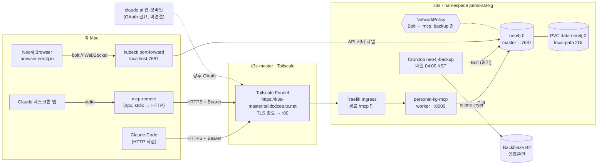
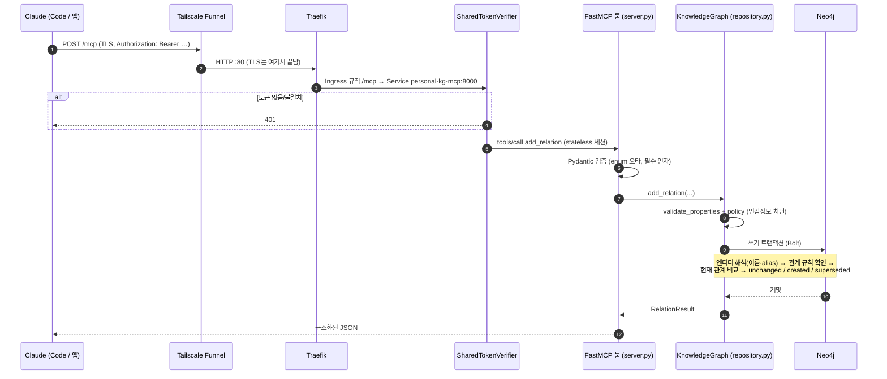
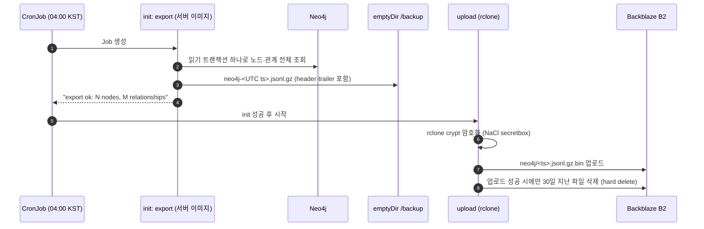
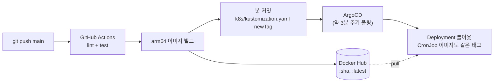

# 요청 흐름

Claude가 툴 하나를 부를 때 요청이 어디를 거쳐 Neo4j까지 가는지, 각 구간에서 무엇을 하고 무엇이 실패할 수 있는지 정리한다. 백업, 배포, 운영자 조회 경로도 함께 그린다.

기준: 2026-10-28. 구성 요소의 설정 근거는 [deployment.md](deployment.md), 서버 내부 계층은 [architecture.md](architecture.md)에 있다.

## 1. 전체 경로

- 인터넷에 열린 입구는 **Funnel 하나**다. Funnel은 Traefik의 80번을 통째로 공개하므로, 실제로 열리는 경로는 Ingress가 정한다. 지금은 `/mcp` 하나다.
- Neo4j(7687)는 인터넷에도, 클러스터 안의 다른 파드에도 열려 있지 않다. 운영자는 `kubectl port-forward`로만 들어간다. 이 터널은 Kubernetes API 서버를 거치므로 kubeconfig 권한이 있어야 한다.
- 데스크톱 앱은 설정에 HTTP 헤더를 넣을 수 없다. 그래서 `mcp-remote`가 로컬에서 stdio 서버인 척하고, 원격으로는 토큰을 붙인 HTTP로 중계한다.

## 2. 툴 호출 한 번: `add_relation`

## 3. 구간별 역할과 실패 모습

| 구간 | 하는 일 | 실패하면 클라이언트가 보는 것 | 확인 |
|---|---|---|---|
| Funnel | 공개 TLS 인증서, TLS 종료 | 연결 자체 실패 | 노드에서 `sudo tailscale funnel status` |
| Traefik | 경로 `/mcp` → Service 라우팅 | 404 (경로 불일치), 502/503 (파드 없음) | `kubectl get ingress -n personal-kg` |
| 토큰 검증 | SHA-256 다이제스트 상수 시간 비교, 토큰 2개(교체용) | 401 | `.env.remote`와 Secret 비교 |
| FastMCP 검증 | 인자 타입·enum | 툴 에러 (validation error) | 에러 메시지에 인자 이름이 나온다 |
| 정책 | 민감정보 키·값 차단 | 툴 에러 (저장 거부) | `docs/security.md` |
| 저장소 | 엔티티 해석, 관계 규칙, 이력 | 툴 에러 ("upsert_entity 먼저", "타입을 붙여라") | 메시지대로 다시 호출 |
| DB 연결 | 백그라운드 연결, 최대 10초 대기 | "not reachable yet" | `kubectl logs deploy/personal-kg-mcp -n personal-kg` |
| Neo4j | 저장, 제약(`entity_key` 유일) | 툴 에러 | `kubectl logs neo4j-0 -n personal-kg` |

## 4. 백업 경로

복구는 반대 방향이다. 로컬 rclone이 내려받으면서 복호화하고, `pkg-mcp-backup restore`가 빈 Neo4j에 넣는다. 절차는 [deployment.md "백업과 복구"](deployment.md#백업과-복구)에 있다.

## 5. 배포 경로

- `k8s/`만 바꾼 커밋은 CI를 건너뛰고 ArgoCD가 바로 반영한다.
- 롤백은 `newTag`를 이전 SHA로 되돌리는 커밋 하나다.
- 걸리는 시간: CI 약 1분 40초(2026-10-27 실측) + ArgoCD 폴링 대기 최대 약 3분.
